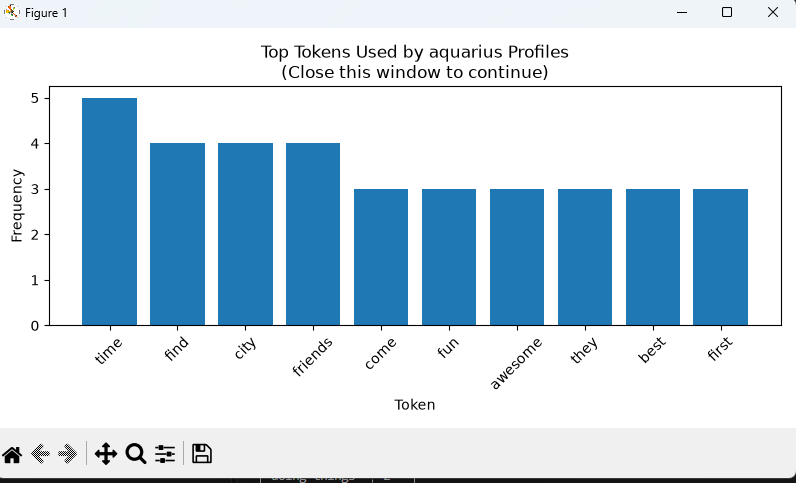
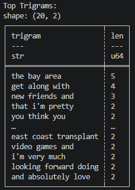
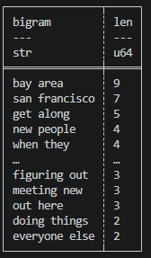

# Web Mining and Applied NLP Project Report

Web Mining and Applied NLP | Project 03 | Example Report

## Author

Britany Goucher

## Date

2026 November

## Overview

This project introduces exploratory analysis
of text corpora.

The objective is to examine how patterns
emerge from token distributions,
category comparisons,
word co-occurrence,
and local word sequences.

The project demonstrates how observable
structure in text can be studied
before applying statistical language models
or machine learning.

The custom project utilizes a dataset from Kaggle,
on dating site information by zodiac sign.

## Tools and Methods

The custom project uses:

- Python for corpus exploration and analysis.
- A small labeled corpus of text documents.
- Tokenization and normalization for text preparation.
- Polars for frequency distributions and category comparisons.
- Context windows for examining word co-occurrence.
- Bigrams for analyzing consecutive word pairs.
- Matplotlib for visualizing token distributions.
- Logging for execution records.
- Ruff, ty, and pytest for code verification.
- Zensical and GitHub Pages for published documentation.
- Trigram Analysis
- Stopword removal

The example corpus contains 22 documents
organized into four categories:
dogs, cats, cars, and trucks.

The analysis compares vocabulary across categories
and examines which words appear near one another.

The custom project corpus contains 50 documents
organized into the 10 different zodiac signs.

## Verification

A successful execution displays:

    Pipeline executed successfully!

The script records execution details in a project log.

The output includes global token frequencies,
category frequency distributions,
co-occurrence examples,
bigram frequencies, and visualizations.

Automated tests provide additional verification
of the project's expected behavior.

## Interpretation

Word frequencies provide information
about the vocabulary of a corpus.

Category comparisons reveal differences
in how words are distributed across documents.

Co-occurrence and bigrams provide additional
information about local word context.

These concepts help establish an understanding
of distributional language patterns
used in statistical NLP,
word embeddings, and modern language models.

## Custom Project Results

With limited sample, at 50 documents, the sign specific analysis is limited.
Trends were present with the bigram and trigram analysis that offered some impactful
insights. "get along with","being around people", and "the bay area" were high result
trigram results. Stopword removal did add more insight into the single token analysis.
Instead of words like and, they, did, you now see words like people,life and friends.

## Custom Project Recommendations

Further analysis of the whole dataset would be very interesting to glean more
meaningful analysis to trend by zodiac sign. Applying trigram analysis to this
dataset appears to be a valuable step to include.

## Documentation Index

- **Home** - this landing page
- [**Project Instructions**](project-instructions.md)
- [**Glossary**](glossary.md)

## Project Links

- [GitHub Repository](https://github.com/BJean-0905/nlp-03-text-exploration)
- [Example Script](https://github.com/BJean-0905/nlp-03-text-exploration/blob/main/src/nlp/nlp_corpus_explore.py)

## Project Resources

- [Project Instructions](project-instructions.md)
- [Professional Python Guide](https://denisecase.github.io/pro-analytics-02/)
- [Professional Python Project Explainer](https://pup-pack.github.io/professional-python-project-explainer/)
